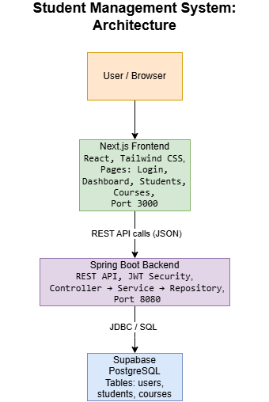
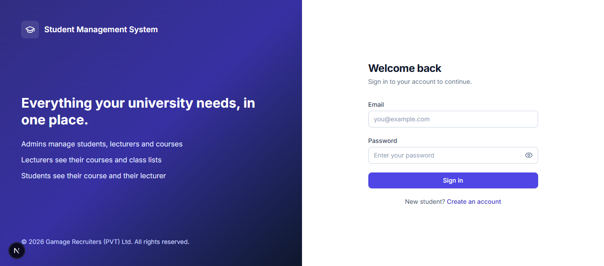
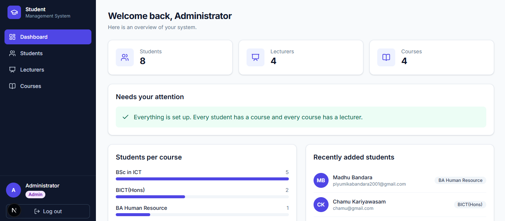
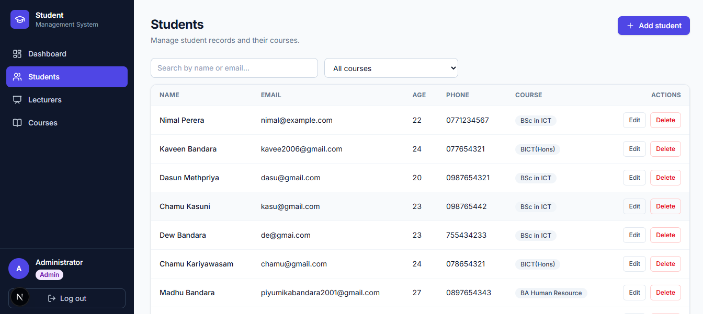
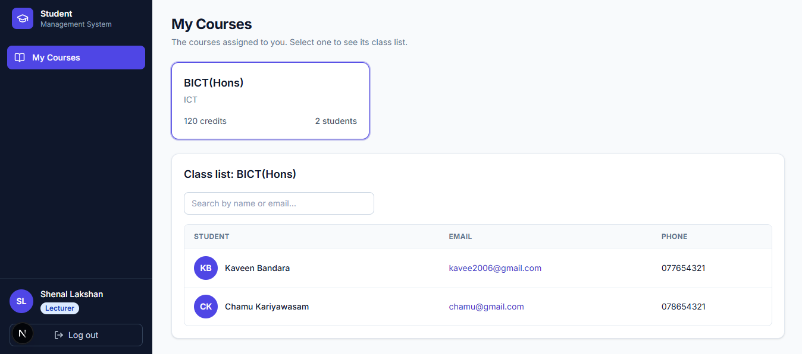
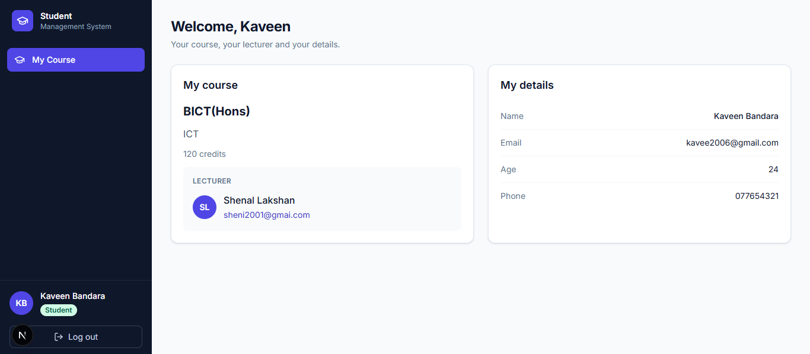

# Student Management System

A full stack web application for managing students, lecturers and courses, with secure login and role-based access for three kinds of users: **Admin**, **Lecturer** and **Student**. It was built as a 5-day internship onboarding project at Gamage Recruiters (PVT) Ltd.

**Live demo:** https://student-management-system-three-lemon.vercel.app/login

## Table of Contents

1. [Project Status](#project-status)
2. [Tech Stack](#tech-stack)
3. [System Architecture](#system-architecture)
4. [Users and Roles](#users-and-roles)
5. [Features](#features)
6. [Project Structure](#project-structure)
7. [Getting Started](#getting-started)
8. [Environment Variables](#environment-variables)
9. [Database Schema](#database-schema)
10. [API Reference](#api-reference)
11. [Security](#security)
12. [Frontend Overview](#frontend-overview)
13. [Testing](#testing)
14. [Design Decisions](#design-decisions)
15. [Known Limitations and Future Work](#known-limitations-and-future-work)
16. [Deployment](#deployment)
17. [Git Commit Standard](#git-commit-standard)
18. [Author](#author)

## Project Status

| Day | Focus | Status |
|---|---|---|
| Day 1 | Planning and environment setup | Completed |
| Day 2 | Database design and backend CRUD APIs | Completed |
| Day 2 (review) | Refactor to DTOs, validation and global exception handling | Completed |
| Day 3 | Frontend UI and API integration | Completed |
| Day 4 | Authentication (JWT), validation, role-based access and security | Completed |
| Day 4 (review) | UI/UX redesign around user roles | Completed |
| Day 5 | Deployment and final documentation | Completed |

## Tech Stack

| Layer | Technology |
|---|---|
| Frontend | Next.js (React), TypeScript, Tailwind CSS, Axios, Lucide icons |
| Backend | Spring Boot 4 (Java 21), Spring Data JPA, Spring Security, Bean Validation, Lombok |
| Authentication | JWT (HS256, using the jjwt library), BCrypt password hashing |
| Database | Supabase (PostgreSQL) |
| Tools | Git, GitHub, Postman, IntelliJ IDEA, VS Code |

## System Architecture



The frontend never accesses the database directly. Every request goes through the Spring Boot REST API, which handles validation, authentication, authorization, business rules and database access.

### Backend design

```
Request JSON  -> Request DTO  -> Controller -> Service -> Entity -> Repository -> Database
Response JSON <- Response DTO <- Service (maps Entity to DTO)
```

| Layer | Responsibility |
|---|---|
| Controller | Receives HTTP requests and returns responses. It has no business logic. |
| Service | Business rules, such as duplicate checks and role checks |
| Repository | Database access with Spring Data JPA |
| Entity | Java classes mapped to database tables |
| DTO | Request and response objects, so entities never leave the service layer |
| Mapper | Converts between entities and DTOs |
| Exception handler | One place that turns exceptions into consistent JSON errors |

## Users and Roles

The system was designed around the people who use it and the tasks each of them needs to perform.

### Personas

| Role | Who they are | Their goal |
|---|---|---|
| **Admin** | University staff who run the system | Keep records accurate, set up courses and lecturers, and see what needs attention |
| **Lecturer** | Teaches one or more courses | See their courses and class lists quickly, without searching through every student |
| **Student** | Learner using the system | See their course, their lecturer and their own details |

### Permission matrix

| Task | Admin | Lecturer | Student |
|---|---|---|---|
| Register, log in, log out | Yes | Yes | Yes |
| View all students | Yes | No | No |
| Create, edit and delete students | Yes | No | No |
| Assign or remove a student's course | Yes | No | No |
| View the list of courses | Yes | No (own courses only) | No (own course only) |
| Create, edit and delete courses | Yes | No | No |
| Assign a lecturer to a course | Yes | No | No |
| Create and delete lecturer accounts | Yes | No | No |
| View own courses and class lists | n/a | Yes | n/a |
| View own course, lecturer and details | n/a | n/a | Yes |
| System overview dashboard | Yes | No | No |

### How accounts are created

| Role | How the account is created |
|---|---|
| Admin | The first admin is created at startup from the `ADMIN_EMAIL` and `ADMIN_PASSWORD` environment variables |
| Lecturer | Created by an admin on the Lecturers page |
| Student | The admin creates the student record, then the student **registers with the same email address**. The email links the login account to the student record. |

Public registration always creates a **Student**, so nobody can give themselves more power.

### Main user flows

1. **Admin sets up a course:** log in, add a lecturer, add a course and choose the lecturer, add students and assign them to the course.
2. **Student gets access:** the admin creates the student record, the student registers with the same email, logs in, and sees **My Course**.
3. **Lecturer checks a class:** log in, open **My Courses**, select a course and view the class list.
4. **Admin finds gaps:** the dashboard's "Needs your attention" panel lists students with no course and courses with no lecturer, with a button to fix each.

## Features

**Authentication and security**
- Registration and login with JWT
- Passwords hashed with BCrypt
- Three roles with different menus, pages and permissions
- Endpoint protection on the server, plus route guards in the browser
- Session restored after a page refresh

**Admin**
- Dashboard with totals, a "Needs your attention" panel, students per course and recent students
- Students: add, edit, delete, search, filter by course, paginate, and assign a course
- Lecturers: add (with a generated temporary password option), search and delete
- Courses: add, edit, delete, search, and assign a lecturer

**Lecturer**
- Their own courses, with student counts
- A searchable class list for each course, with email links

**Student**
- Their own course, the lecturer's contact details and their personal details

**User experience**
- Responsive layout: a sidebar on desktop and a drawer menu on mobile
- Modal forms with labelled fields and inline validation messages
- Toast notifications for success and failure
- Confirmation dialogs for deletions, with a warning about the effect
- Loading, error and empty states on every page

**API quality**
- DTOs for all requests and responses
- Validation on every request, with clear messages
- One consistent JSON error format
- Duplicate email prevention (students and users, case-insensitive)

## Project Structure

```
Student Management System/
├── frontend/                       # Next.js application
│   └── src/
│       ├── app/
│       │   ├── layout.tsx          # root layout with all providers
│       │   ├── page.tsx            # redirects to the right home page
│       │   ├── login/              # public
│       │   ├── register/           # public
│       │   └── (protected)/
│       │       ├── layout.tsx      # the single layout: sidebar shell and route guard
│       │       ├── dashboard/
│       │       ├── students/
│       │       ├── lecturers/
│       │       ├── courses/
│       │       ├── my-courses/     # lecturer home
│       │       └── my-course/      # student home
│       ├── components/             # AppShell, AuthGuard, Modal, FormField, Badge, ...
│       ├── context/                # Auth, Toast and Confirm providers
│       ├── lib/                    # axios instance, token storage, roles and route rules
│       ├── services/               # API calls
│       └── types/                  # TypeScript types matching the backend DTOs
├── backend/                        # Spring Boot application
│   └── src/main/java/com/gamage/student_management_system/
│       ├── config/                 # SecurityConfig, AdminSeeder
│       ├── controller/             # REST controllers
│       ├── dto/
│       │   ├── request/            # input DTOs with validation
│       │   └── response/           # output DTOs
│       ├── entity/                 # JPA entities and the Role enum
│       ├── exception/              # custom exceptions and global handler
│       ├── mapper/                 # entity <-> DTO conversion
│       ├── repository/             # Spring Data JPA repositories
│       ├── security/               # JWT service, authentication filter, error handler
│       └── service/                # business logic
├── postman/                        # Postman collection for API testing
└── docs/                           # diagrams and documentation
```

## Getting Started

### Prerequisites

- Node.js (LTS)
- JDK 21
- Git
- A Supabase project (the free tier is enough)
- Postman (optional, for API testing)

### 1. Clone the repository

```bash
git clone https://github.com/DeshaniBandara/Student-Management-System.git
cd Student-Management-System
```

### 2. Prepare the database

1. Create a project in [Supabase](https://supabase.com).
2. Open **Connect** and copy the **Session pooler** connection details (host, port, database and user).
3. Keep your database password safe. It is never stored in this repository.

The tables are created automatically by Hibernate when the backend starts (`spring.jpa.hibernate.ddl-auto=update`).

### 3. Generate a JWT secret

The secret must be at least 32 random bytes, Base64 encoded. In PowerShell:

```powershell
$bytes = New-Object byte[] 32
[System.Security.Cryptography.RandomNumberGenerator]::Create().GetBytes($bytes)
[Convert]::ToBase64String($bytes)
```

### 4. Run the backend

Set the environment variables (see the next section), then run from the `backend` folder.

Windows (PowerShell):

```powershell
cd backend
$env:DB_URL="jdbc:postgresql://<host>:5432/postgres"
$env:DB_USERNAME="<your-db-username>"
$env:DB_PASSWORD="<your-db-password>"
$env:JWT_SECRET="<base64-secret>"
$env:ADMIN_EMAIL="<admin-email>"
$env:ADMIN_PASSWORD="<admin-password>"
.\mvnw.cmd spring-boot:run
```

Mac/Linux:

```bash
cd backend
export DB_URL="jdbc:postgresql://<host>:5432/postgres"
export DB_USERNAME="<your-db-username>"
export DB_PASSWORD="<your-db-password>"
export JWT_SECRET="<base64-secret>"
export ADMIN_EMAIL="<admin-email>"
export ADMIN_PASSWORD="<admin-password>"
./mvnw spring-boot:run
```

You can also set the variables in an IntelliJ run configuration. The API runs on `http://localhost:8080`. On the first start, the admin account is created automatically.

### 5. Run the frontend

Create `frontend/.env.local` with `NEXT_PUBLIC_API_URL=http://localhost:8080`, then:

```bash
cd frontend
npm install
npm run dev
```

The app runs on `http://localhost:3000`. Start the backend first.

### 6. Try the system

1. Log in with the admin email and password you set.
2. Add a lecturer, then a course (choose the lecturer), then a student (with an email address and a course).
3. Log out, **register** with the student's email address, and log in to see the Student view.
4. Log in as the lecturer to see the Lecturer view.

## Environment Variables

Example files are provided as `.env.example`. **Never commit real values.**

### Backend

| Variable | Required | Description |
|---|---|---|
| `DB_URL` | Yes | JDBC URL of the Supabase database, such as `jdbc:postgresql://<host>:5432/postgres` |
| `DB_USERNAME` | Yes | Database username |
| `DB_PASSWORD` | Yes | Database password |
| `JWT_SECRET` | Yes | Base64 secret of at least 32 bytes, used to sign tokens |
| `ADMIN_EMAIL` | Yes (first run) | Email of the admin account created at startup |
| `ADMIN_PASSWORD` | Yes (first run) | Password of that admin account (8 to 72 characters, with a letter and a number) |
| `CORS_ALLOWED_ORIGINS` | For deployment | Comma-separated list of allowed frontend origins. Defaults to `http://localhost:3000,http://localhost:3001`. |

### Frontend

| Variable | Description |
|---|---|
| `NEXT_PUBLIC_API_URL` | Base URL of the backend, such as `http://localhost:8080` |

## Database Schema

| Table | Columns |
|---|---|
| `users` | id, full_name, email (unique), password (BCrypt hash), role (`ADMIN`, `LECTURER` or `STUDENT`) |
| `students` | id, first_name, last_name, email (unique), age, phone, course_id (FK to `courses`) |
| `courses` | id, title, description, credits, lecturer_id (FK to `users`) |

**Relationships**

- A course has many students, and each student belongs to one course (one-to-many).
- A course has one lecturer, and a lecturer can teach many courses (one-to-many).
- A login account for a student is linked to a student record by **email address**.

Row Level Security is enabled on all tables in Supabase. The backend connects directly to the database, so it isn't affected, and the tables cannot be read through Supabase's public API.

## API Reference

Base URL: `http://localhost:8080` (local) or the deployed backend URL.

Every endpoint except register and login needs the header `Authorization: Bearer <token>`.

### Authentication

| Method | Endpoint | Access | Description | Success |
|---|---|---|---|---|
| POST | `/api/auth/register` | Public | Register a new **student** account | 201 |
| POST | `/api/auth/login` | Public | Log in and receive a JWT | 200 |
| GET | `/api/auth/me` | Any logged-in user | The current user | 200 |

### Courses

| Method | Endpoint | Access | Description | Success |
|---|---|---|---|---|
| GET | `/api/courses` | Any logged-in user | List all courses | 200 |
| GET | `/api/courses/{id}` | Any logged-in user | Get a course | 200 |
| GET | `/api/courses/{id}/students` | Admin | List the students of a course | 200 |
| POST | `/api/courses` | Admin | Create a course | 201 |
| PUT | `/api/courses/{id}` | Admin | Update a course (including its lecturer) | 200 |
| DELETE | `/api/courses/{id}` | Admin | Delete a course. Its students are left without a course. | 204 |

### Students

| Method | Endpoint | Access | Description | Success |
|---|---|---|---|---|
| GET | `/api/students` | Admin | List all students | 200 |
| GET | `/api/students/{id}` | Admin | Get a student | 200 |
| POST | `/api/students` | Admin | Create a student | 201 |
| PUT | `/api/students/{id}` | Admin | Update a student | 200 |
| PUT | `/api/students/{studentId}/course/{courseId}` | Admin | Assign a course to a student | 200 |
| DELETE | `/api/students/{studentId}/course` | Admin | Remove a student's course | 200 |
| DELETE | `/api/students/{id}` | Admin | Delete a student | 204 |

### Lecturers

| Method | Endpoint | Access | Description | Success |
|---|---|---|---|---|
| GET | `/api/admin/lecturers` | Admin | List lecturers | 200 |
| POST | `/api/admin/lecturers` | Admin | Create a lecturer account | 201 |
| DELETE | `/api/admin/lecturers/{id}` | Admin | Delete a lecturer. Their courses are left without a lecturer. | 204 |
| GET | `/api/lecturer/courses` | Lecturer | The lecturer's own courses | 200 |
| GET | `/api/lecturer/courses/{courseId}/students` | Lecturer | The class list of one of their own courses | 200 |

### Student self-service

| Method | Endpoint | Access | Description | Success |
|---|---|---|---|---|
| GET | `/api/me/student` | Student | The student's own record, course and lecturer | 200 |

### Request and response examples

**Register** (`POST /api/auth/register`)

```json
{
  "fullName": "Nimal Perera",
  "email": "nimal@example.com",
  "password": "Pass1234"
}
```

**Login response** (`POST /api/auth/login`)

```json
{
  "token": "eyJhbGciOiJIUzI1NiJ9...",
  "tokenType": "Bearer",
  "expiresInSeconds": 86400,
  "user": {
    "id": 3,
    "fullName": "Nimal Perera",
    "email": "nimal@example.com",
    "role": "STUDENT"
  }
}
```

**Create a course** (`POST /api/courses`)

```json
{
  "title": "BSc in ICT",
  "description": "Information and Communication Technology",
  "credits": 120,
  "lecturerId": 2
}
```

**Create or update a student** (`POST /api/students`, `PUT /api/students/{id}`)

```json
{
  "firstName": "Nimal",
  "lastName": "Perera",
  "email": "nimal@example.com",
  "age": 21,
  "phone": "0771234567",
  "courseId": 1
}
```

**Student response**

```json
{
  "id": 1,
  "firstName": "Nimal",
  "lastName": "Perera",
  "email": "nimal@example.com",
  "age": 21,
  "phone": "0771234567",
  "course": {
    "id": 1,
    "title": "BSc in ICT",
    "description": "Information and Communication Technology",
    "credits": 120,
    "lecturer": {
      "id": 2,
      "fullName": "Nimali Silva",
      "email": "lecturer@example.com",
      "role": "LECTURER"
    },
    "studentCount": 1
  }
}
```

### Validation rules

| Field | Rule |
|---|---|
| Register: full name | required, max 255 characters |
| Register and login: email | required, valid email |
| Register: password | 8 to 72 characters, with at least one letter and one number |
| Course title | required, max 255 characters |
| Course description | optional, max 1000 characters |
| Course credits | required, positive whole number |
| Student first and last name | required, max 255 characters |
| Student email | required, valid email, unique |
| Student age | optional, 1 to 120 |
| Student phone | optional, 7 to 15 characters (digits, `+`, `-`, spaces) |

### Error responses

All errors use one consistent format:

```json
{
  "timestamp": "2026-10-18T05:41:00.188Z",
  "status": 400,
  "error": "Bad Request",
  "message": "Validation failed",
  "path": "/api/students",
  "validationErrors": {
    "firstName": "First name is required",
    "email": "Email must be valid"
  }
}
```

| Status | When |
|---|---|
| 400 | Validation failed, malformed JSON, or an invalid value in the URL |
| 401 | No token, an invalid or expired token, or a wrong email or password |
| 403 | Logged in, but the role does not allow this action |
| 404 | The record or endpoint does not exist |
| 405 | The HTTP method is not supported for this endpoint |
| 409 | Duplicate email |
| 500 | Unexpected server error. Details are logged on the server only. |

## Security

| Area | How it is handled |
|---|---|
| Passwords | Hashed with BCrypt, never stored or returned in plain text. Responses use DTOs without a password field. |
| Authentication | Stateless JWT, signed with HS256, valid for 24 hours. It carries the email and the role. |
| Authorization | URL rules in Spring Security. The JWT filter reloads the user on every request, so deleted users lose access immediately. |
| Registration | Always creates a Student. Lecturers are created by an admin, and the first admin comes from environment variables. |
| Secrets | Database credentials, `JWT_SECRET` and the admin password live only in environment variables. They are never committed. |
| CORS | Only the configured frontend origins may call the API. |
| CSRF | Disabled on purpose, because the API is stateless and uses a bearer token, not cookies. |
| Database | Row Level Security is enabled on all Supabase tables. |
| Error handling | Clients get safe messages. Stack traces and details stay in the server log. |
| Frontend | Route guards give a good user experience, and the backend independently enforces every rule. |

## Frontend Overview

| Route | Who can open it | Purpose |
|---|---|---|
| `/login` | Public | Sign in |
| `/register` | Public | Create a student account |
| `/dashboard` | Admin | Overview and attention panel |
| `/students` | Admin | Manage students |
| `/lecturers` | Admin | Manage lecturers |
| `/courses` | Admin | Manage courses and lecturer assignment |
| `/my-courses` | Lecturer | Own courses and class lists |
| `/my-course` | Student | Own course, lecturer and details |

How it is organized:

- **One protected layout** wraps every logged-in page with the sidebar and the route guard.
- **One route access list** (`lib/roles.ts`) defines which role may open which route.
- **One Axios instance** attaches the token to every request and handles an expired token.
- **Service files** keep all API calls in one place.
- **Shared components** (Modal, FormField, Badge, Avatar, EmptyState, PageHeader, StatCard) keep the look consistent.

## Testing

- **API tests:** a Postman collection is stored in `postman/`. Start the backend, log in to get a token, and add it as a Bearer token to each request.
- **Manual test checklist**
  - Log in as each of the three roles and check the menu and home page.
  - A student opening an admin page sees "Access denied".
  - A request with no token returns 401, and a student token on an admin endpoint returns 403.
  - Duplicate emails return 409, and invalid input returns 400 with clear messages.
  - Add, edit, delete and assign work for students, courses and lecturers, and the data matches Supabase.
  - The layout works at phone width.

Automated unit and integration tests are listed under future work.

## Design Decisions

- **DTOs everywhere:** entities never leave the service layer, so passwords stay private and clients can't set fields like `id`.
- **One course per student, one lecturer per course:** a deliberate scope for the 5-day task. Many-to-many enrollment is listed as future work.
- **Student accounts linked by email:** the simplest reliable link between a login account and a student record, with no extra table.
- **Registration creates students only:** this is the main protection against privilege escalation.
- **A single protected layout and one route access list**, instead of a layout per page, in response to the team review.
- **Role-specific homes and menus**, in response to the UX review: each person sees only the tasks that are theirs.
- **Deleting in-use records:** deleting a course leaves its students without a course, and deleting a lecturer leaves their courses unassigned. The admin sees a warning first, and the dashboard shows what needs reassigning.

## Known Limitations and Future Work

**Limitations**

- Each student has one course, and each course has one lecturer.
- The JWT is stored in `localStorage`. A production system would use an httpOnly cookie with refresh tokens.
- There is no password reset or change-password feature yet.
- There are no automated tests yet. The API was tested with Postman and the UI by hand.
- The schema is managed by `ddl-auto=update`. A production system would use migrations such as Flyway.
- If the backend runs on a free hosting tier, the first request after a period of inactivity can be slow.

**Future work**

- Modules with many-to-many enrollment, and self-enrollment with capacity limits
- Grades and attendance, announcements and a timetable
- Refresh tokens, password reset by email, and login rate limiting
- Unit and integration tests, and a CI pipeline
- Server-side pagination and sorting, CSV import and export
- An audit log and soft deletes

## Deployment

| Part | Platform | Link |
|---|---|---|
| Frontend | Vercel | https://student-management-system-three-lemon.vercel.app |
| Backend | _add backend link_ | _add backend link_ |
| Database | Supabase (PostgreSQL) | managed by Supabase |

Deployment settings

- **Frontend:** `NEXT_PUBLIC_API_URL` is set to the backend URL.
- **Backend:** all variables from the table above are set on the host, and `CORS_ALLOWED_ORIGINS` contains the frontend URL.

## Screenshots

Screenshots are in `docs/screenshots/`.

| Screen | Image |
|---|---|
| Login |  |
| Admin dashboard |  |
| Students |  |
| Lecturer: My Courses |  |
| Student: My Course |  |

## Git Commit Standard

This project follows [Conventional Commits](https://www.conventionalcommits.org):

```
type(scope): short description
```

Rules: a lowercase type, present tense, no full stop at the end, and a scope when relevant.

Types used: `feat`, `fix`, `docs`, `style`, `refactor`, `perf`, `test`, `chore`, `config`, `ci`, `build`.

Examples: `feat(auth): implement JWT login`, `fix(ui): fix button alignment on mobile`, `refactor(api): restructure controller logic`, `docs: update readme`.

## Author

Deshani Bandara
Software Engineering Intern, Gamage Recruiters (PVT) Ltd.